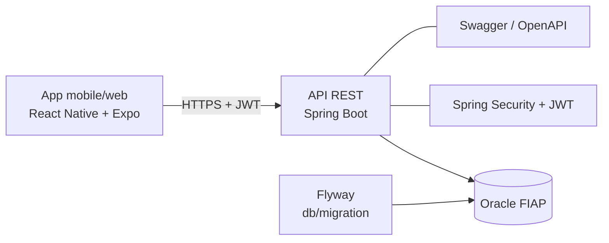

# ProntPet

App de gestão veterinária: **tutores** cadastram seus pets e agendam consultas; **clínicas** acompanham a agenda e registram o atendimento (sintomas, diagnóstico, peso). Um **administrador** supervisiona o sistema.

## Integrantes

- Anthony de Souza Henriques — RM 566188
- Guilherme Santos Fonseca — RM 564232
- Gustavo Araujo da Silva — RM 566526

## Links da entrega (4ª Sprint)

| Item | Link |
|---|---|
| Aplicação online (API + Swagger) | `<PREENCHER: https://.../swagger-ui.html>` |
| Front-end online | `<PREENCHER: link do front web ou do Expo>` |
| Vídeo de apresentação (até 15 min) | `<PREENCHER: link do YouTube não listado>` |
| Repositório Back-End | https://github.com/Challenge-2TDSPX-2026/JavaProntPet |
| Repositório Front-End | https://github.com/Challenge-2TDSPX-2026/MobileProntPet |

**Acesso para avaliação:** `<PREENCHER: e-mail/senha de um tutor, de uma clínica e do admin de teste>`

---

## 1. O problema e a solução

Tutores de pets costumam ter o histórico do animal espalhado em papéis, mensagens e memória, e clínicas pequenas controlam agenda e prontuário de forma manual. O ProntPet centraliza isso:

- o tutor mantém os dados dos pets e agenda consultas em clínicas, com validação do horário de funcionamento e de conflito de agenda;
- a clínica vê apenas as consultas dela e registra o atendimento, o que atualiza o peso do pet;
- cada perfil acessa só o que é seu (ver [Permissões](#4-perfis-e-permissões)).

### Fluxos principais (além de CRUD)

1. **Tutor:** cadastro → login → cadastra pet → escolhe clínica → agenda consulta (valida horário da clínica e conflito) → acompanha/cancela.
2. **Clínica (VET):** login → lista consultas da própria clínica → registra o atendimento (sintomas, diagnóstico, observações, peso) → o peso do pet é atualizado e o histórico fica disponível ao tutor.
3. **Admin:** visão geral de tutores, pets e consultas.

## 2. Arquitetura



Camadas do back-end (`br.com.project.prontpet`):

| Pacote | Responsabilidade |
|---|---|
| `controllers` | Rotas REST, validação (`@Valid`) e regra de perfil (`@PreAuthorize`) |
| `services` | Regras de negócio e regra "só mexe no que é seu" |
| `repositories` | Spring Data JPA |
| `models` | Entidades JPA (nunca expostas no JSON) |
| `dtos` | Contratos de entrada/saída da API |
| `security` | JWT, filtro, `CurrentUser` (quem está logado) |
| `config` | Seed do admin, cache |
| `exceptions` | Respostas de erro padronizadas (400/401/403/404/409) |

## 3. Tecnologias e decisões

| Escolha | Por quê |
|---|---|
| Spring Boot 4 + Java 17 | Base da disciplina; ecossistema completo para API REST |
| JWT stateless | Funciona bem com app mobile e não exige sessão no servidor |
| Entidade única `Account` (email/senha/role) ligada a `Owner` ou `Clinic` | Um login para qualquer perfil, sem duplicar autenticação |
| DTOs em toda a API | Não vazar CPF, hash de senha nem relacionamentos internos |
| `CurrentUser` + `@PreAuthorize` | Regra de acesso em um só lugar, sem repetir `SecurityContextHolder` |
| Flyway + `ddl-auto=validate` | Schema versionado; o Hibernate só valida |
| Cache (`@Cacheable`) nas listagens de pets | Reduz consultas repetidas; invalidado quando o peso muda numa consulta |
| Paginação (`Pageable`) | Listagens de pets escaláveis |
| Swagger (springdoc) | Documentação viva e teste das rotas |
| Docker (multi-stage, não-root) | Mesmo artefato em qualquer nuvem |

## 4. Perfis e permissões

| Recurso | ROLE_USER (tutor) | ROLE_VET (clínica) | ROLE_ADMIN |
|---|---|---|---|
| `POST /auth/register`, `POST /auth/login` | público | público | — (admin é criado por seed) |
| `GET /clinics` | ✔ | ✔ | ✔ |
| `POST /clinics` | ✖ | ✖ | ✔ |
| `PUT/DELETE /clinics/{id}` | ✖ | só a própria | ✔ |
| `GET /owners`, `POST /owners` | ✖ | ✖ | ✔ |
| `GET/PUT/DELETE /owners/{id}` | só o próprio | ✖ | ✔ |
| `GET /pets` e filtros | ✖ | ✖ | ✔ |
| `GET /pets/me` | ✔ | ✖ | — |
| `GET /pets/{id}` | só os seus | se tiver consulta na clínica | ✔ |
| `POST/PUT/DELETE /pets` | só os seus | ✖ | ✔ |
| `GET /appointment` | ✖ | ✖ | ✔ |
| `GET /appointment?petId=` | só os seus | só da própria clínica | ✔ |
| `GET /appointment/clinic/me`, `/clinic/{id}` | ✖ | só a própria | ✔ |
| `POST /appointment` | só para seus pets | ✖ | ✔ |
| `PUT /appointment/{id}` (atendimento) | ✖ | só da própria clínica | ✔ |
| `DELETE /appointment/{id}` | só os seus | só da própria clínica | ✔ |

Sem token (ou token inválido) a API responde **401**; sem permissão, **403**.

## 5. Como rodar localmente

**Pré-requisitos:** JDK 17, Maven e acesso ao Oracle da FIAP.

### Variáveis de ambiente

| Variável | Exemplo |
|---|---|
| `DB_URL` | `jdbc:oracle:thin:@oracle.fiap.com.br:1521:orcl` |
| `DB_USERNAME` | RM do aluno |
| `DB_PASSWORD` | senha do Oracle |
| `JWT_SECRET` | string aleatória com 32+ caracteres |
| `ADMIN_EMAIL` / `ADMIN_PASSWORD` | cria o administrador no startup (opcional) |
| `CORS_ALLOWED_ORIGINS` | origens do front, separadas por vírgula (padrão `*`) |

```bash
./mvnw spring-boot:run
```

O Flyway aplica as migrations na primeira execução. A API sobe em `http://localhost:8080`.

- Swagger: `http://localhost:8080/swagger-ui.html` (**Authorize** → `Bearer <token>`)
- Health: `http://localhost:8080/actuator/health`

### Com Docker

```bash
docker build -t prontpet-api .
docker run -p 8080:8080 \
  -e DB_URL=... -e DB_USERNAME=... -e DB_PASSWORD=... -e JWT_SECRET=... \
  -e ADMIN_EMAIL=admin@prontpet.com -e ADMIN_PASSWORD=... \
  prontpet-api
```

### Testes

```bash
./mvnw test -Dtest='RequestValidationTest,CurrentUserTest,AppointmentServiceSecurityTest'
```

Cobrem validação dos DTOs, regra de acesso (`CurrentUser`) e a regressão "VET não edita consulta de outra clínica". Não precisam de banco.

## 6. Deploy

Passo a passo (Render ou Azure) em [`docs/DEPLOY.md`](docs/DEPLOY.md).

## 7. Banco de dados

Schema 100% versionado em `src/main/resources/db/migration/`:

| Migration | O que faz |
|---|---|
| `V1__criar_tabelas.sql` | Tabelas de conta, tutor, clínica, pet e consulta |
| `V2__renomear_coluna_dignosis.sql` | Corrige o nome da coluna `diagnosis` |
| `V3__unique_account_email.sql` | E-mail da conta único no banco |

Mudança de estrutura = nova migration; nunca editar uma já aplicada.

## 8. Integração multidisciplinar

> Ajuste/complete esta tabela com o que o grupo realmente entregou em cada disciplina.

| Disciplina | Como entrou no projeto | Evidência |
|---|---|---|
| Java Advanced | API REST, Security/JWT, Flyway, validação, cache, paginação, Swagger | Este repositório |
| Banco de dados | Modelagem relacional no Oracle e scripts versionados | `db/migration/*.sql`, `documents/Diagramas ProntPet.pdf` |
| DevOps & Cloud | Containerização e deploy em nuvem | `Dockerfile`, `docs/DEPLOY.md` |
| Mobile | App React Native consumindo a API | Repositório MobileProntPet |
| Disruptive Architectures (IA) | CLYVO VET: modelo preditivo de risco clínico do pet (XGBoost), no mesmo domínio de pets e consultas | Repositório Modelo-IA-ClyvoVet |
| Gestão do projeto | Backlog, cronograma e sprints | `documents/Cronograma ProntPet.pdf` |

## 9. Documentos e coleção de testes

- `documents/Diagramas ProntPet.pdf`
- `documents/Cronograma ProntPet.pdf`
- `documents/postman-prontPet.json` (coleção Postman)

## 10. Front-end

Repositório: [MobileProntPet](https://github.com/Challenge-2TDSPX-2026/MobileProntPet).

```bash
npm install
npx expo start
```

Configure a URL da API no config do app (use a URL do deploy; `10.0.2.2:8080` só para emulador Android local).
